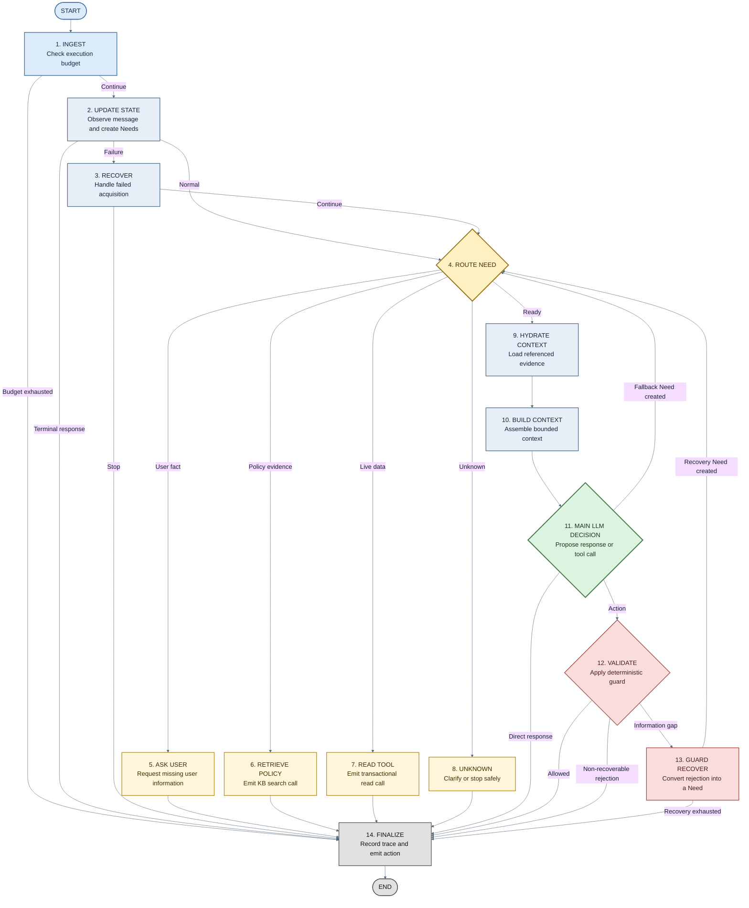

# PolicyPilot

PolicyPilot is an open-source banking policy agent built for reliable,
tool-grounded decision making. It extends the tau2/tau3 benchmark runtime with a
bounded LangGraph workflow, structured information needs, hybrid retrieval,
guarded tool use, memory, skills, and detailed evaluation traces.

## Business Scenario

Banking assistants must combine two different kinds of information:

- **Policy knowledge**: product terms, fees, rewards, eligibility rules,
  referrals, disputes, and account procedures.
- **Live user state**: accounts, balances, transaction status, eligibility, and
  other facts that must be verified through tools.

PolicyPilot is designed for multi-constraint requests such as comparing cards,
finding a product with no annual fee, checking whether a user qualifies, or
completing an account operation without treating unverified user claims or old
memory as authoritative facts.

The current benchmark domain is `banking_knowledge`. The `mock` domain is kept
only as a lightweight fixture for runtime tests.

## Runtime

PolicyPilot keeps the benchmark runtime and the agent's internal reasoning
separate:

```text
tau2 Orchestrator
  -> sends UserMessage / ToolMessage
  -> PolicyPilotAgent.generate_next_message()
       -> observe and update task state
       -> select the next blocking Need
       -> ask user, retrieve policy, or read a live tool
       -> build a bounded decision context
       -> Decision LLM proposes a response or ToolCall
       -> Guard validates and repairs the proposal
  -> returns AssistantMessage / ToolCall
  -> tau2 Environment executes tools
  -> tau2 Evaluator scores the completed trajectory
```

The outer tau2 layer owns conversation turns, environment state, tool execution,
user simulation, and evaluation. The inner LangGraph workflow is bounded and
produces one externally visible action per turn. Tools still execute only in the
tau2 environment.

### LangGraph Topology



Need creation is an internal capability rather than a standalone graph node:

- `update_state` creates initial Need candidates from deterministic semantic
  parsing, a conditionally invoked lightweight semantic planner, and baseline
  goal-derived seeds. `NeedRegistry` then deduplicates and registers them.
- `decision` may create a bounded fallback Need when the main model identifies
  missing information that prevents a grounded decision.
- `guard_recover` converts a recoverable validation failure into a new Need and
  routes it back through the same acquisition workflow.

`retrieve_policy` and `read_tool` emit tool calls but do not execute them. The
tau2 environment executes each call outside LangGraph, and the resulting
`ToolMessage` enters the graph through `update_state` on the next turn.

## Main Components

| Component | Responsibility |
| --- | --- |
| Task state | Stores the current Goal, Facts, Information Needs, Evidence, control state, and history. |
| Requirement and Need planning | Converts user intent into small, typed information gaps with priorities and dependencies. |
| Acquisition routing | Decides whether a Need requires a user question, policy retrieval, or live transactional read. |
| Hybrid retrieval | Searches policy chunks with lexical and dense retrieval, then reranks candidate evidence. |
| Evidence and coverage | Links retrieved or tool-verified evidence to Needs and identifies what remains unresolved. |
| Context engineering | Selects relevant evidence, compresses long tool output, preserves references, and rehydrates details on demand. |
| Decision LLM | Produces the final natural-language response or concrete tool call from the compact grounded context. |
| Guard and recovery | Checks tool availability, arguments, budgets, duplicate calls, and failed retrievals before an action is emitted. |
| Long-term memory | Stores durable user preferences and past episodes outside task state; it never replaces live banking verification. |
| Skills | Supplies reusable workflow guidance and references without taking tool authority away from the main model. |
| Observability and evaluation | Records node traces, Needs, retrieval queries, tool calls, tokens, cost, latency, and benchmark rewards. |

## Quick Start

PolicyPilot requires Python 3.12.

```powershell
uv sync --extra knowledge --extra dev
Copy-Item .env.example .env
```

Configure the model credentials in `.env`. Local dense retrieval and episodic
memory use the configured Ollama embedding model; the vector index can run with
local Qdrant persistence.

Run one benchmark task:

For the default `local_hybrid` retrieval mode, the runner checks Ollama before
task execution. If it is offline, it automatically discovers and runs a sibling
`qwen-api/start-qwen-api.ps1`, then verifies the configured embedding model with
a real embedding request. Set `POLICYPILOT_OLLAMA_START_SCRIPT` when the script
is stored elsewhere. Use `--skip-runtime-preflight` only when Ollama is managed
externally or the selected retrieval mode does not require it.

```powershell
python scripts/evaluate_v1.py `
  --task-ids task_001 `
  --agent-model deepseek/deepseek-chat `
  --user-model deepseek/deepseek-chat `
  --seed 0 `
  --max-steps 40 `
  --max-errors 10 `
  --save-to task001_seed0
```

Trajectories and evaluator results are written to
`data/simulations/<run-name>/tasks/<task-id>/results.json`.

## Tests

```powershell
$env:PYTHONPATH = (Resolve-Path .\src).Path
.\.venv\Scripts\python.exe -m pytest tests\policypilot -q
.\.venv\Scripts\python.exe -m pytest tests\test_domains\test_banking_knowledge -q
```

More details are available in
[`docs/policypilot`](docs/policypilot), including architecture, evaluation,
memory, and version-history documents.
